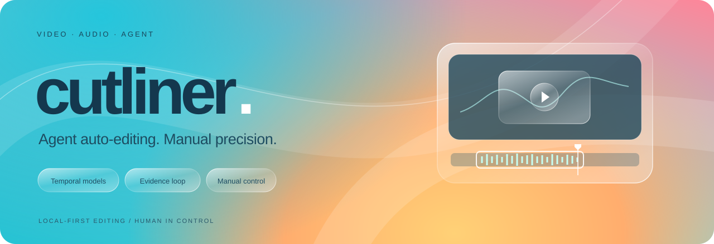
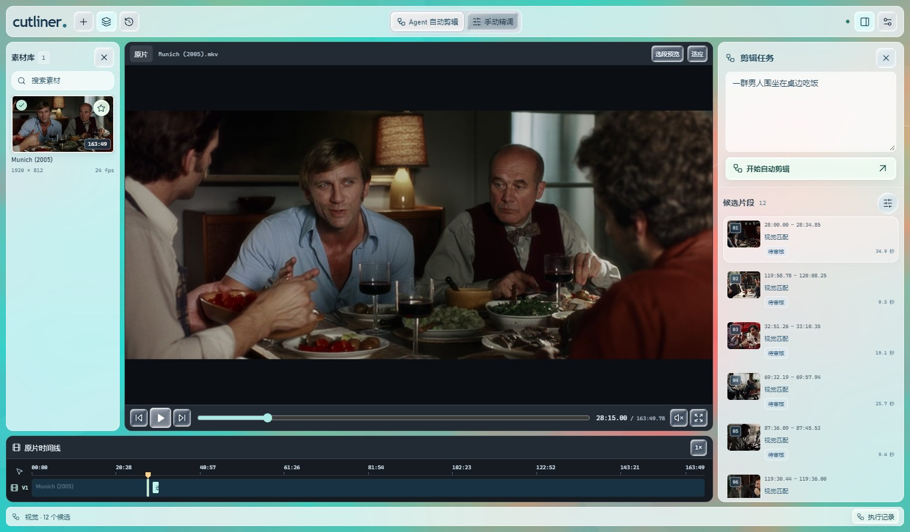
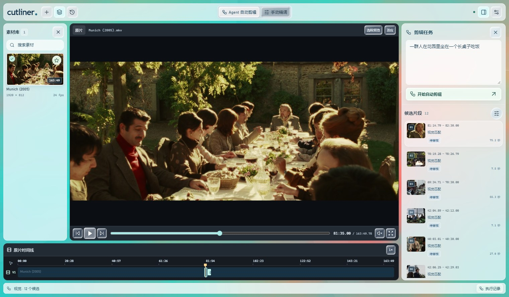
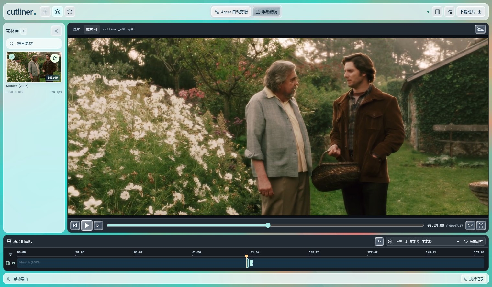
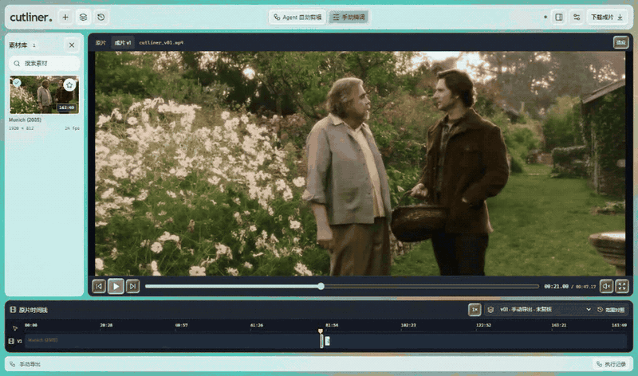
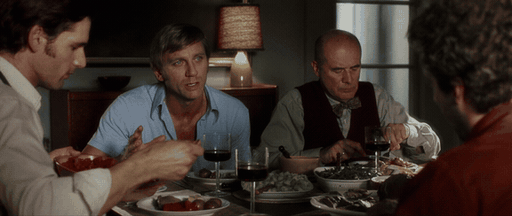
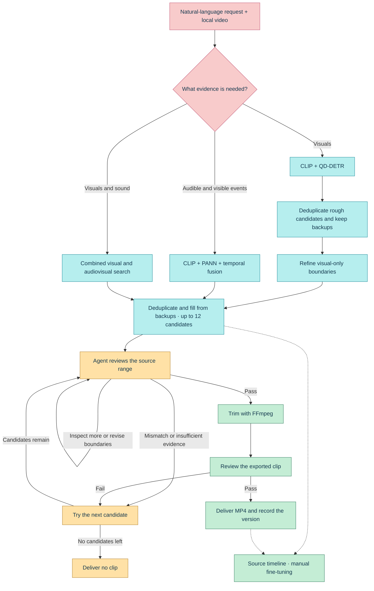

<p align="center">
  <a href="README.md">简体中文</a> · <strong>English</strong>
</p>

<p align="center">
  
</p>

<p align="center">
  <strong>From a plain-language request to a clip you can verify.</strong><br>
  Describe what you want to see or hear. Cutliner finds it in long footage, checks the evidence, and cuts the clip.<br>
  Let the agent handle the workflow, or fine-tune the result on the timeline.
</p>

<p align="center">
  
  
  
  
</p>

<p align="center">
  <a href="#overview">Overview</a> ·
  <a href="#demo">Demo</a> ·
  <a href="#how-it-works">How it works</a> ·
  <a href="#evaluation">Evaluation</a> ·
  <a href="#quick-start">Quick start</a> ·
  <a href="#repository-layout">Repository layout</a>
</p>

## Overview

Cutliner finds and cuts specific moments in long footage. For example, you can look for “a group of men eating around a table” in a feature film or “a dog is visible and you can hear it barking” in a long recording. Give it a video and a natural-language request. It returns candidate ranges you can preview on the original timeline or a downloadable MP4.

| Feature | What it does |
| :--- | :--- |
| **Long-video search** | Searches by visuals, audiovisual events, or both. Results are time ranges in the source video, not just similar-looking frames. |
| **Agent editing** | Checks whether a candidate satisfies your request, inspects more evidence when needed, and can adjust the boundaries. It then cuts and verifies the result. If the evidence is insufficient, it does not deliver a clip. |
| **Manual fine-tuning** | Scrub the source, adjust in/out points, and compare model suggestions, agent revisions, and previous clip versions. Each version is available to download. |

Source videos, exports, and project records stay on your machine. **Local search does not call a cloud model.** If you authorize automatic editing or review, the request text or selected candidate frames may be sent to the configured provider.

## Demo

***Munich* (2005) · Approximately 2 hours and 44 minutes.** The top result for “a group of men eating around a table” is at **00:28:00–00:28:35**. For “people eating at a long table in a garden,” the top result is at **01:21:15–01:22:30**.

<a href="docs/assets/munich-table-search.jpg">
  
</a>

| Dinner at a long table in the garden · Top result | Garden conversation · 47-second clip preview |
| :---: | :---: |
| [](docs/assets/munich-garden-search.jpg) | [](docs/assets/munich-clip-preview.jpg) |
| 01:21:15–01:22:30 | Source: 01:20:25–01:21:12 |

### Play the clip and compare source ranges



<details>
<summary>Watch a 3.5-second excerpt from the dinner scene</summary>



</details>

With video features already cached, **local search and boundary refinement took about 27 seconds** for the garden conversation and flower-picking request. This is one warm-cache run; it excludes initial feature extraction, cloud review, and export. Film images are used to demonstrate the software; the repository does not distribute the original movie or full exported clips.

## How it works



1. **Retrieve and deduplicate candidates.** The models use sparsely sampled visual features to locate relevant ranges, preserve the full field of view in widescreen footage, and cache features so new queries do not need to extract them again. Visual-only tasks can read a denser set of nearby frames and apply a text-conditioned temporal model to refine the boundaries. Heavily overlapping and nested ranges occupy one slot; lower-ranked distinct ranges fill the remaining slots. Refined ranges are checked for overlap again.
2. **Decide based on evidence.** A model candidate is not a verified match. The agent can inspect frames, call a local audiovisual detector, and look just outside the proposed cut. For visual-only automatic tasks, it can propose a new range, which must be reviewed again. Cutliner delivers the first result that passes both the source and exported-clip checks.
3. **Keep edits traceable.** The React workbench shares a candidate list and source timeline across editing modes. FFmpeg exports clips. SQLite or PostgreSQL persists media, job, and version records; a service restart does not automatically replay cloud requests.

[Local retrieval](mini_agent/video/neural_retriever.py) · [Boundary refinement](mini_agent/video/boundary_refiner.py) · [Review agent](mini_agent/video/review_agent.py) · [Export workflow](mini_agent/video/local_search.py)

## Evaluation

| Comparison | Metrics | Baseline → improved |
| :--- | :--- | :--- |
| AVE-derived audiovisual task: visual-only → audiovisual temporal fusion | Macro F1 / R@1 (tIoU ≥ 0.5) | **73.3% → 81.0%** / **66.8% → 76.8%** |
| Charades-STA localization: coarse Top-1 → local refinement + Top-3 reranking | Mean tIoU / boundary MAE | **0.202 → 0.336** / **8.94 s → 6.63 s** |

The audiovisual comparison covers 215 distinct source videos and 28 event classes. The boundary comparison uses 2,355 queries with annotated target intervals. Both aggregate three fixed seeds. These are **component-level results**, not an end-to-end editing success rate. The Top-3 result also observes more candidates than Top-1, so its full gain cannot be attributed to the reranker alone.

[Audiovisual results](docs/evaluation/heldout-results.json) · [Boundary results](docs/evaluation/boundary-results.json) · [Training configuration](docs/evaluation/training-config.json)

## Quick start

### 1. Start the local workbench

Tested on Windows with Python 3.11 and Node.js 22. The SQLite option does not require Docker:

```powershell
git clone --recurse-submodules https://github.com/lansunny/cutliner.git
cd cutliner
conda create -n cutliner python=3.11 -y
conda activate cutliner
python -m pip install -r requirements.txt
.\scripts\start-studio.ps1 -Database sqlite
```

Open [http://127.0.0.1:7861/](http://127.0.0.1:7861/) and import a video. The startup script builds the frontend when needed. If Docker Desktop is installed, run `.\scripts\start-studio.ps1` to start a local PostgreSQL instance instead.

### 2. Set up local visual search

From the repository root, create a separate model environment, install its dependencies, and download the upstream weights. For NVIDIA GPUs, see the [PyTorch CUDA installation guide](https://pytorch.org/get-started/locally/).

```powershell
python -m venv experiments/video_grounding_local/.venv
experiments/video_grounding_local/.venv/Scripts/python.exe -m pip install -r requirements-models.txt
experiments/video_grounding_local/.venv/Scripts/python.exe experiments/video_grounding_local/prepare_models.py
```

In the workbench, choose Manual Fine-tuning (「手动精调」), open the search settings, and enter an English visual query. To check the local candidate output without calling a cloud model, you can also run:

```powershell
python video_main.py --video "D:/Videos/input.mp4" --request "Find a person picking up a cup" --visual-query-en "A person picking up a cup" --retrieve-only --no-boundary-refine
```

### 3. Enable agent editing and trained models

- **Agent editing:** Copy [`.env.example`](.env.example) to a local `.env`, configure DeepSeek and Qwen, and restart. Cloud calls require per-task consent and may incur charges.
- **Local boundary refinement:** Prepare the weights listed in the [boundary model manifest](experiments/boundary_refiner_local/approved_boundary_model.json) and set `LOCAL_BOUNDARY_ARTIFACT_ROOT`. To try upstream visual search without this model, set `$env:LOCAL_BOUNDARY_MODEL = "off"` before starting the workbench.
- **Audiovisual and combined search:** Prepare the deployment files listed in the [audiovisual model manifest](experiments/av_grounding_local/approved_event_model.json) and set `LOCAL_AV_EVENT_RUN`. Trained weights and training data are not distributed with the repository.

## Repository layout

| Path | Purpose |
| :--- | :--- |
| [`frontend/`](frontend/) | Editing workbench, playback, timeline, and version comparison |
| [`studio_server.py`](studio_server.py) · [`studio_store.py`](studio_store.py) | Local API, job orchestration, and persistence |
| [`mini_agent/video/`](mini_agent/video/) | Routing, candidate selection, boundary refinement, review, and export |
| [`experiments/`](experiments/) | Local models, training, and component evaluation |
| [`docs/`](docs/) | Demos and evaluation results |

## Limitations

- The audiovisual model covers **28 audible and visible event classes**. It does not search for specific dialogue, off-screen sounds, or conditions such as “no music.”
- Candidate matching does not verify every frame. The system may miss complex actions or relationships and cannot reliably determine absence when evidence is limited.
- An automatic task delivers at most one verified clip, not a multi-clip montage. Visual boundary refinement does not alter ranges that must preserve audio evidence.

<sub>Models and datasets: [Lighthouse](https://github.com/line/lighthouse) · [QD-DETR](https://github.com/wjun0830/QD-DETR) · [CLIP](https://github.com/openai/CLIP) · [PANNs](https://github.com/qiuqiangkong/audioset_tagging_cnn) · [AVE](https://github.com/YapengTian/AVE-ECCV18) · [Charades-STA](https://github.com/jiyanggao/TALL). UI: [Vanta](https://github.com/tengbao/vanta) · [Three.js](https://github.com/mrdoob/three.js) · [Ashi Liquid Glass](https://github.com/the-Ashkanian/ashi-liquid-glass) · [Lucide](https://lucide.dev/).</sub>
