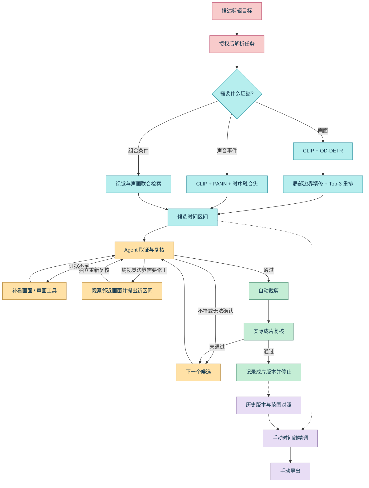

<p align="center">
  
</p>

<p align="center">
  <strong>从一句需求，到可复核的成片。</strong><br/>
  深度学习定位与精修边界，Agent 按需取证、修正、裁剪和复核。<br/>
  自动完成主要流程，也把每个入点与出点留给你掌控。
</p>

<p align="center">
  
  
  
  
</p>

<p align="center">
  <a href="#核心能力">核心能力</a> ·
  <a href="#工作原理">工作原理</a> ·
  <a href="#实验结果">实验结果</a> ·
  <a href="#开始使用">开始使用</a> ·
  <a href="#能力边界">能力边界</a>
</p>

<p align="center">
  
</p>

## 核心能力

**模型定位 → Agent 取证与修正 → 裁剪复核 → 成片交付。**

| 神经网络定位 | Agent 自动剪辑 | 手动接管 |
| :--- | :--- | :--- |
| 按需求选择视觉、声画或联合路径；纯视觉候选再经过局部边界精修与 Top-3 重排。 | 按需补看、核对条件；纯视觉任务可提出边界修正，重新审核后裁剪，再复核实际成片。 | 切回原片时间线，结合音轨波形调整入点与出点；对照模型建议、Agent 修正和历史成片范围。 |

- **可追踪的自动执行**：行动台展示已执行的工具动作、当前候选与交付状态。
- **成片有版本**：独立预览、下载历史成片；切换版本不改当前选段，点击“应用此范围”才进入精调。
- **审核不串用**：修改范围后需重新核验；成片文件缺失或版本改变，不沿用原来的通过结论。
- **任务可管理**：支持停止、显式重试和历史恢复；服务重启不自动重跑，云端重试需要重新授权。
- **双模式工作台**：大尺寸任务输入区、彩色动态背景与液态玻璃控件，自动剪辑和手动精调共用素材与任务记录。

原视频与项目记录保留在本机。授权云端解析与复核时，**需求文本和选中的候选画面会发送至所配置的模型服务**，可能产生 API 费用；密钥只由后端读取。

## 工作原理



### 01 / 模型找到候选，也修正边界

视觉分支使用 **QD-DETR** 对 CLIP 视频特征与英文查询进行条件交互，输出粗候选。局部边界网络在候选附近重新读取更密集的真实画面，通过 **文本条件调制、时序 Transformer 和区间质量预测**提出边界，再由可训练的候选排序器重排 Top-3。原始粗定位和模型证据保留，精修不等于语义审核通过。

声画分支冻结 **CLIP ViT-B/32 + PANN Cnn6** 编码器，训练轻量时序融合头，定位支持类别中“有声且可见”的事件。组合条件可以使用两个分支的候选证据。**视觉边界网络只在纯视觉路径启用**，不静默改动带声音约束的区间。

源码：[检索与路由](mini_agent/video/neural_retriever.py) · [边界网络接入](mini_agent/video/boundary_refiner.py) · [边界训练与推理](experiments/boundary_refiner_local/)

### 02 / Agent 根据证据选择下一步

`POST /api/auto-edit` 串联任务解析、模型检索、候选复核、裁剪与成片复核。Agent 在有限预算下使用以下工具，而不是对整条视频反复调用视觉大模型：

| 动作 | 作用 |
| :--- | :--- |
| `inspect_frames` | 观察候选内部尚未查看的画面。 |
| `inspect_av_events` | 为支持的声音条件补充本地声画证据。 |
| `inspect_context` | 纯视觉源片段复核时，观察候选附近的原片。 |
| `propose_boundary` | 引用已观察帧提出起止边界，由程序校验并重新审核。 |
| `finish` | 根据证据通过、拒绝或保留不确定，不强行交付。 |

边界提议不能直接变成“通过”：新区间需要重新取证，导出后还要检查实际文件。邻近上下文也不能替最终成片证明符合要求。当前策略是 **首个源区间与成片均通过复核后停止**，不是全视频最佳片段排序；候选耗尽或审核受阻时不会标记交付成功。行动台只展示实际执行摘要，不展示内部推理。

源码：[复核 Agent](mini_agent/video/review_agent.py) · [边界提议校验](mini_agent/video/boundary_repair.py) · [候选到交付](mini_agent/video/local_search.py)

### 03 / 人能接管，结果能回看

手动精调始终使用原视频时间坐标。模型建议、Agent 修正、当前选段与成片版本分别保留；切换预览不会自动覆盖编辑范围，直接手动导出的版本明确标记为未经内容复核。

任务状态与操作记录持久化。停止后保留已有记录，重试沿用原任务和原范围；历史成片分别记录来源区间与复核状态，恢复时重新检查文件是否仍是对应版本。

源码：[工作台 API](studio_server.py) · [任务生命周期](studio_jobs.py) · [历史与版本](mini_agent/video/studio_history.py) · [范围对照界面](frontend/src/ArtifactVersions.tsx)

## 实验结果

以下是**模型组件的独立评测**，不是整个 Agent 的成片成功率；两组任务和指标不能横向混比。

### 声画融合：相比纯视觉，声音证据带来什么？

AVE 衍生闭集任务，**215 个独立原始视频源、28 类事件、3 个预声明随机种子**的平均结果：

| 方法 | 帧级 Macro F1 ↑ | 事件查询 R@1，tIoU ≥ 0.5 ↑ |
| :--- | ---: | ---: |
| 纯视觉时序模型 | 73.3% | 66.8% |
| **声画时序融合** | **81.0%** | **76.8%** |
| **绝对提升** | **+7.7 个百分点** | **+10.0 个百分点** |

同源数据按视频分组清理，训练、开发和测试来源互不重叠；模型模式在开发集选定，部署固定使用预声明的 seed 42。相对纯视觉对照，两项指标的按源配对 bootstrap 95% 置信区间下界均大于零。

这组结果来自 **AVE 衍生的闭集声画任务**，不是任意长视频检索或整个 Agent 的端到端成功率；音频编码器预训练来源为 AudioSet。原始评测输出与实验配置见 [评测结果](docs/evaluation/heldout-results.json) 和 [训练配置](docs/evaluation/training-config.json)。

### 局部边界：相比粗定位，区间是否更贴近目标？

Charades-STA 严格完整正例子集，**2,355 条查询、3 个冻结种子**的平均结果：

| 方法 | 平均 tIoU ↑ | 目标区间覆盖率 ↑ | 边界 MAE ↓ |
| :--- | ---: | ---: | ---: |
| QD-DETR 粗定位 Top-1 | 0.202 | 31.5% | 8.94 s |
| 局部精修 Top-1 | 0.295 | 41.1% | 7.51 s |
| 局部精修 + 固定质量 Top-3 选择 | 0.321 | 43.6% | 6.94 s |
| **局部精修 + 可训练 Top-3 重排** | **0.336** | **47.4%** | **6.63 s** |

目标区间覆盖率指输出覆盖真实事件时长的比例，**不是检索召回率或语义正确率**。Top-3 路径观察更多候选，不能把相对粗定位的全部增益都归因于排序网络。这是有目标的区间定位实验，不是完整官方测试集、无目标判别或亚秒级剪辑保证；影视长视频与端到端成片效果仍需单独评测。部署使用预声明的 seed 17，不按测试结果挑选种子，也不是三模型集成。

[发布结果摘要](docs/evaluation/boundary-results.json) · [冻结评测实现](experiments/boundary_refiner_local/evaluate_final.py) · [部署资产清单](experiments/boundary_refiner_local/approved_boundary_model.json)

## 开始使用

当前本地工作台以 **Windows + Python 3.11 + Node.js 22** 为验证环境。应用与深度学习模型使用两个 Python 环境；原视频、数据集、缓存和模型权重不随源码分发。

### 1 / 获取源码与依赖

首次获取项目时执行：

```powershell
git clone --recurse-submodules https://github.com/lansunny/cutliner.git
cd cutliner
conda create -n cutliner python=3.11 -y
conda activate cutliner
python -m pip install -r requirements.txt
cd frontend
npm ci
npm run build
cd ..
python studio_server.py
```

打开 [http://127.0.0.1:7861/](http://127.0.0.1:7861/)。点击“导入素材”选择自己的视频；此时可以查看工作台和媒体，执行检索还需准备模型环境。已有源码但未获取子模块时，先执行 `git submodule update --init --recursive`。

### 2 / 配置视觉检索

另开终端，在仓库根目录为模型创建独立环境，并下载上游公开权重：

```powershell
conda activate cutliner
python -m venv experiments/video_grounding_local/.venv
experiments/video_grounding_local/.venv/Scripts/python.exe -m pip install -r requirements-models.txt
experiments/video_grounding_local/.venv/Scripts/python.exe experiments/video_grounding_local/prepare_models.py
```

有 NVIDIA GPU 时，请先按 [PyTorch 官方安装说明](https://pytorch.org/get-started/locally/)选择对应的 CUDA wheel。默认也可以使用 CPU，长视频处理会更慢。

**首次只使用公开上游权重时，显式跳过尚未准备的自训练边界模型：**

```powershell
python video_main.py --video "D:/Videos/input.mp4" --request "找到人物拿起杯子的片段" --visual-query-en "A person picking up a cup" --retrieve-only --no-boundary-refine
```

这条命令只生成本地候选，不调用云端解析或复核。通过界面检索时，在启动服务的终端设置 `$env:LOCAL_BOUNDARY_MODEL = "off"`，重新启动 `python studio_server.py`；切到“手动精调”，在检索设置中关闭云端智能解析、填写英文视觉查询。

### 3 / 启用 Agent 自动剪辑

复制 [`.env.example`](.env.example) 为本机 `.env`，填写 DeepSeek 与千问 API 配置，重启后端。默认配置使用 DeepSeek 进行任务解析与工具决策，千问视觉模型观察候选画面。

导入素材 → 输入需求 → 点击“开始自动剪辑” → 授权本次云端解析与画面复核。授权前不会发起云端调用；API Key 不替代本地模型环境和权重。任务可主动停止，但已发送的 API 请求仍可能计费。

### 4 / 配置自训练模型资产

| 模块 | 配置与要求 |
| :--- | :--- |
| 局部边界精修与 Top-3 重排 | 准备与 [边界清单](experiments/boundary_refiner_local/approved_boundary_model.json) 匹配的本地检查点，设置 `LOCAL_BOUNDARY_ARTIFACT_ROOT`；模型环境不同可设置 `LOCAL_BOUNDARY_PYTHON`。移除 `LOCAL_BOUNDARY_MODEL=off` 后重启。 |
| 声画 / 联合检索 | 准备与 [声画清单](experiments/av_grounding_local/approved_event_model.json) 匹配的完整部署资产，通过 `LOCAL_AV_EVENT_RUN` 和 `LOCAL_AV_EVENT_PYTHON` 指定位置与环境。 |

两个清单都**不是权重下载包**。默认纯视觉路径会尝试使用边界模型；没有对应资产时请显式关闭，而不是期待自动降级。声画任务缺少模型或遇到不支持的声音条件时，也不会偷偷改成纯视觉检索。

## 项目结构

```text
cutliner/
├── frontend/                    React / TypeScript 剪辑工作台
├── studio_server.py             本地媒体、任务、历史和成片 API
├── studio_jobs.py               停止、重试与重启恢复
├── video_main.py                视频检索命令行入口
├── mini_agent/video/            检索、边界接入、复核 Agent 与导出
├── experiments/
│   ├── neural_retrieval/        检索执行器、部署评测与流程检查
│   ├── video_grounding_local/  QD-DETR 推理与固定版本上游子模块
│   ├── boundary_refiner_local/ 局部边界网络、候选重排、训练与评测
│   ├── av_grounding_local/     声画时序模型、训练及独立评测
│   └── action_verifier_local/  早期动作核验实验
└── docs/                       项目展示素材与评测依据
```

## 能力边界

- 声画网络支持 **28 类有声且可见的事件**，不识别任意动作、具体台词、画外声或否定声音条件。
- QD-DETR 与边界模型提出的是候选，不保证人物关系或复杂动作都正确；边界模型没有训练通用无目标拒绝能力，也不保证修正后更短。
- Agent 是预算内的多帧核验，仍可能漏看或误判；通过不代表逐帧保证。当前每次自动任务交付一段通过的成片，不生成完整多段混剪。
- 主动边界修正目前仅用于自动纯视觉源片段复核，不改动声音或联合任务的边界；服务重启恢复记录，不恢复执行或自动补跑。
- 当前界面不是多轨非线性编辑器；不包含转场、字幕生成、多人协作或云端项目同步。
- 完整液态玻璃折射主要在 Chromium 浏览器生效；其他浏览器保留模糊与高光，WebGL 不可用时使用 CSS 背景。

## 致谢

检索与视觉特征基于 [Lighthouse](https://github.com/line/lighthouse)、[QD-DETR](https://github.com/wjun0830/QD-DETR)、[UniVTG](https://github.com/showlab/UniVTG) 和 [CLIP](https://github.com/openai/CLIP)；音频编码参考 [PANNs](https://github.com/qiuqiangkong/audioset_tagging_cnn)。声画实验数据来源为 [AVE](https://github.com/YapengTian/AVE-ECCV18)，边界实验使用 [Charades-STA](https://github.com/jiyanggao/TALL) 时间区间标注。

界面使用 [Vanta](https://github.com/tengbao/vanta)、[Three.js](https://github.com/mrdoob/three.js)、[Ashi Liquid Glass](https://github.com/the-Ashkanian/ashi-liquid-glass) 与 [Lucide](https://lucide.dev/)，视觉方向参考 [Taste Skill](https://github.com/Leonxlnx/taste-skill)、[Interface Design](https://github.com/Dammyjay93/interface-design)、[Formwork](https://github.com/shellcat-com/formwork) 和 [DecorativeBackgrounds](https://github.com/Mamboleoo/DecorativeBackgrounds)。第三方代码与资源保留各自的许可证。
