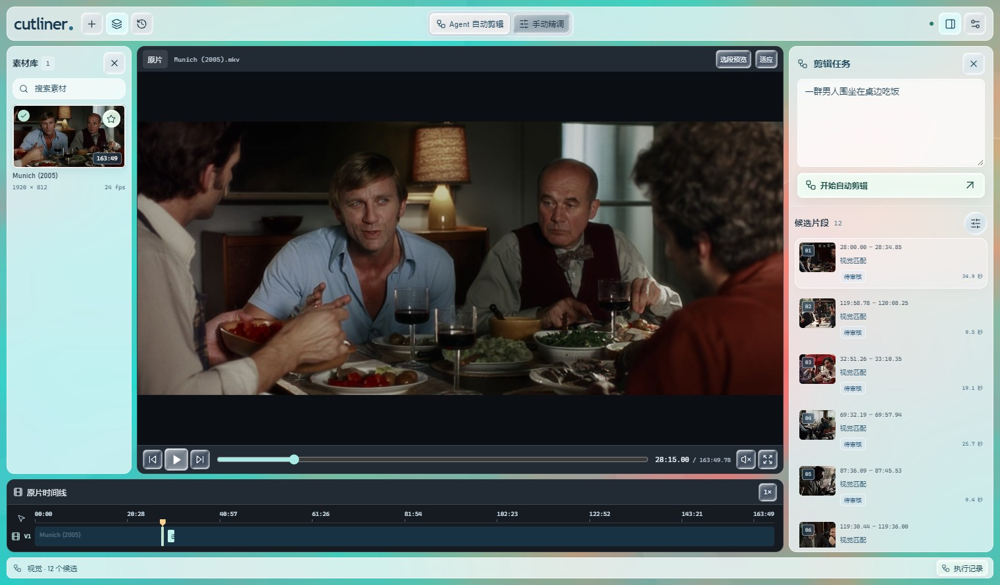
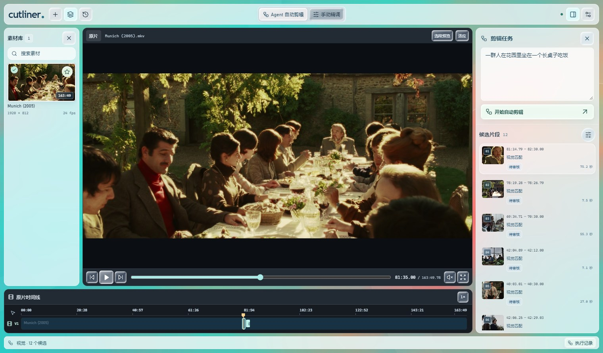
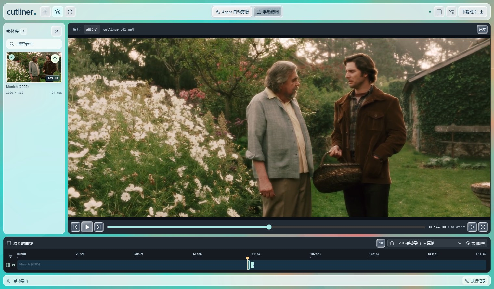

<p align="center">
  
</p>

<p align="center">
  <strong>说出你想找的画面，从整部长视频直接跳到片段。</strong><br>
  Cutliner 用本地模型定位画面和声画事件，由 Agent 取证、裁剪并复核成片。
</p>

<p align="center">
  <a href="#长视频实录">长视频实录</a> · <a href="#技术亮点">技术亮点</a> · <a href="#开始使用">开始使用</a>
</p>

## 长视频实录

**《慕尼黑》（2005）· 全片 2 小时 44 分钟。** 输入「一群男人围坐在桌边吃饭」，首个候选直接定位到 **00:28:00–00:28:35**。换成「一群人在花园里坐在一个长桌子吃饭」，首个候选定位到 **01:21:15–01:22:30**。

<a href="docs/assets/munich-table-search.jpg">
  
</a>

| 花园长桌 · 首位命中 | 花园谈话 · 47 秒成片预览 |
| :---: | :---: |
| [](docs/assets/munich-garden-search.jpg) | [](docs/assets/munich-clip-preview.jpg) |
| 01:21:15–01:22:30 | 原片 01:20:25–01:21:12 |

同一部电影的「花园谈话摘花」任务复跑时，**复用全片特征后，本地检索与边界精修约 27 秒**。这是单次热缓存结果，不含首次建索引、云端复核或导出。电影截图仅用于展示软件效果，仓库不分发原片或剪辑视频。

## 技术亮点

- **全片找事件**：CLIP + QD-DETR 做文本条件视觉定位，声画分支用 CLIP + PANN 与轻量时序融合头。保留原画幅，复用视频特征；候选先去重，再从后续结果补位，最多保留 12 条。
- **Agent 按证据剪辑**：只在候选附近补看，必要时修正边界；通过源区间审核后才裁剪，并检查实际成片。没有候选通过时，不强行交付。
- **可接管的工作台**：大幅预览、原片时间线和独立候选栏；支持入点／出点精调、版本对照与执行记录。PostgreSQL 或 SQLite 保存本地素材和任务状态。

### 对照结果

| 对照实验 | 增益 |
| :--- | :--- |
| AVE 衍生声画任务：对比纯视觉分支 | Macro F1 **73.3% → 81.0%**，R@1 **66.8% → 76.8%** |
| Charades-STA：粗定位 Top-1 → 局部精修 + Top-3 重排 | 平均 tIoU **0.202 → 0.336**，边界 MAE **8.94s → 6.63s** |

以上是独立组件对照，不是端到端成片成功率。[声画评测](docs/evaluation/heldout-results.json) · [边界评测](docs/evaluation/boundary-results.json) · [检索](mini_agent/video/neural_retriever.py) · [复核 Agent](mini_agent/video/review_agent.py)

## 开始使用

验证环境：Windows、Python 3.11、Node.js 22。

```powershell
git clone --recurse-submodules https://github.com/lansunny/cutliner.git
cd cutliner
conda create -n cutliner python=3.11 -y
conda activate cutliner
python -m pip install -r requirements.txt
cd frontend
npm ci
npm run build
cd ..
.\scripts\start-studio.ps1
```

打开 [本地工作台](http://127.0.0.1:7861/) 导入素材。默认通过 Docker Desktop 启动本地 PostgreSQL；不安装 Docker，可用 `.\scripts\start-studio.ps1 -Database sqlite`。

<details>
<summary>准备检索模型与 Agent</summary>

在仓库根目录创建独立模型环境，安装依赖并下载上游视觉权重：

```powershell
python -m venv experiments/video_grounding_local/.venv
experiments/video_grounding_local/.venv/Scripts/python.exe -m pip install -r requirements-models.txt
experiments/video_grounding_local/.venv/Scripts/python.exe experiments/video_grounding_local/prepare_models.py
```

- **本地视觉检索**：在检索设置中填写英文视觉查询。尚未配置边界权重时，可设置 `$env:LOCAL_BOUNDARY_MODEL = "off"` 后启动工作台。NVIDIA GPU 请安装适配的 [PyTorch CUDA 版本](https://pytorch.org/get-started/locally/)。
- **Agent 自动剪辑**：复制 [`.env.example`](.env.example) 为本机 `.env`，填写 DeepSeek 与千问配置后重启。云端解析与复核需要逐任务授权，发送需求文本及候选画面，可能计费。
- **自训练模块**：[边界模型清单](experiments/boundary_refiner_local/approved_boundary_model.json) 对应 `LOCAL_BOUNDARY_ARTIFACT_ROOT`；[声画模型清单](experiments/av_grounding_local/approved_event_model.json) 对应 `LOCAL_AV_EVENT_RUN`。自训练权重、测试数据和原视频不随仓库分发。

</details>

声画分支覆盖 **28 类**有声且可见的事件，不检索具体台词。自动任务最多交付一段通过复核的成片。

模型与数据参考：[Lighthouse](https://github.com/line/lighthouse)、[QD-DETR](https://github.com/wjun0830/QD-DETR)、[CLIP](https://github.com/openai/CLIP)、[PANNs](https://github.com/qiuqiangkong/audioset_tagging_cnn)、[AVE](https://github.com/YapengTian/AVE-ECCV18) 和 [Charades-STA](https://github.com/jiyanggao/TALL)。界面使用 [Vanta](https://github.com/tengbao/vanta)、[Three.js](https://github.com/mrdoob/three.js)、[Ashi Liquid Glass](https://github.com/the-Ashkanian/ashi-liquid-glass) 和 [Lucide](https://lucide.dev/)。
