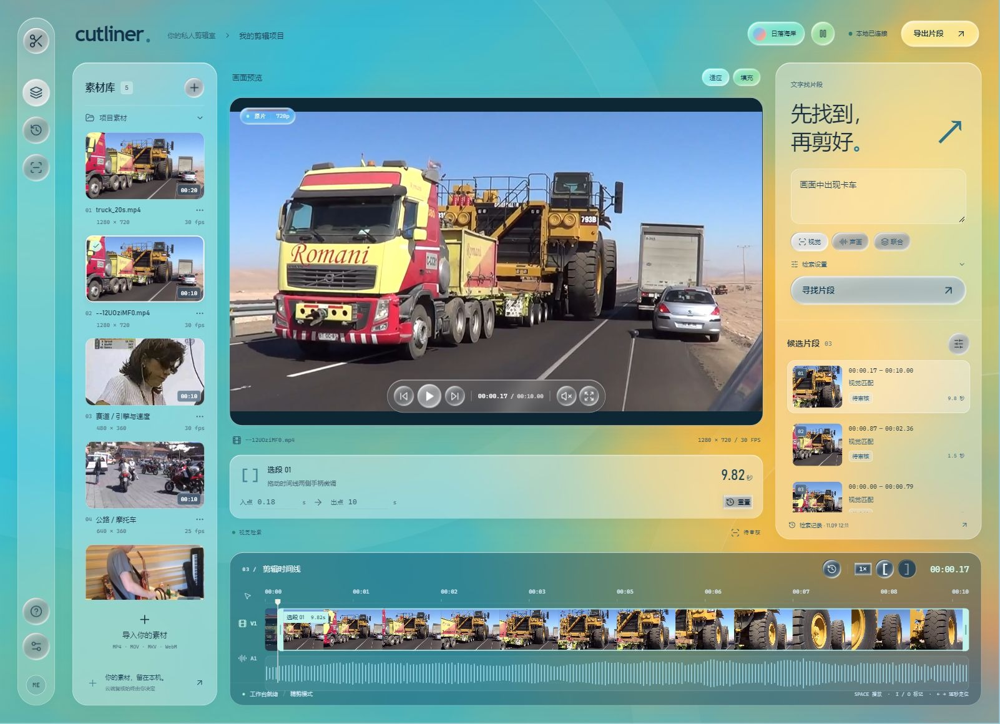
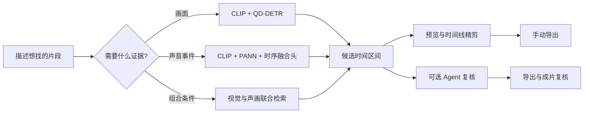

<p align="center">
  
</p>

<p align="center">
  <strong>一句描述，找到视频里的那一幕。</strong><br/>
  深度学习定位画面与声音，Agent 复核候选，时间线完成精剪。
</p>

<p align="center">
  
  
  
  
</p>

<p align="center">
  <a href="#体验">体验</a> ·
  <a href="#工作原理">工作原理</a> ·
  <a href="#实验结果">实验结果</a> ·
  <a href="#开始使用">开始使用</a> ·
  <a href="#能力边界">能力边界</a>
</p>

<p align="center">
  
</p>

## 体验

**找到 → 看清 → 剪好 → 导出。**

| 找到内容 | 判断片段 | 完成剪辑 |
| :--- | :--- | :--- |
| 按画面、声音或组合条件检索，自动选择对应的本地模型路径。 | 在候选区间中预览；按需让 Agent 补看画面、调用声画工具，核验完整需求。 | 拖动入点和出点，结合真实音轨波形精剪，导出保留声音的 MP4。 |

- **流动的工作台**：WebGL 彩色背景、三套配色、可暂停动画与液态玻璃按钮；适配桌面和手机。
- **完整的剪辑操作**：素材导入、历史检索、候选预览、时间线裁剪、快捷键与成片下载。
- **本地优先**：媒体和任务记录保存在本机。云端需求解析与视觉复核需单独授权，API 密钥只由后端读取。

## 工作原理



### 检索先行，Agent 后置

视觉分支使用 **QD-DETR**：对 CLIP 视觉特征与英文查询进行条件交互，预测相关时间区间。声画分支冻结 **CLIP ViT-B/32** 与 **PANN Cnn6** 编码器，训练轻量时序融合头，定位支持类别中“有声且可见”的事件。复合需求可以使用两个分支的候选证据。

Agent 只在候选产生后工作，通过 `inspect_frames`、`inspect_av_events` 与 `finish` 形成受预算约束的复核循环。它可以补充证据、拒绝不符片段或确认输出；模型分数本身不等于审核通过。当前自动交付策略为**首个通过的片段生成后停止**。

手动导出和自动复核是两条独立路径：前者尊重时间线的裁剪范围，后者核验原始候选并执行后台交付策略，不会把手动导出的文件冒充已审核结果。

## 实验结果

声画模块在 **215 个独立原始视频源、28 类事件、3 个预声明随机种子**上的平均结果：

| 方法 | 帧级 Macro F1 ↑ | 事件查询 R@1，tIoU ≥ 0.5 ↑ |
| :--- | ---: | ---: |
| 纯视觉时序模型 | 73.3% | 66.8% |
| **声画时序融合** | **81.0%** | **76.8%** |
| **绝对提升** | **+7.7 个百分点** | **+10.0 个百分点** |

同源数据按视频分组清理，训练、开发和测试来源互不重叠；模型模式在开发集选定，部署固定使用预声明的 seed 42。相对纯视觉对照，两项指标的按源配对 bootstrap 95% 置信区间下界均大于零。

这组结果来自 **AVE 衍生的闭集声画任务**，不是任意长视频检索或整个 Agent 的端到端成功率；音频编码器预训练来源为 AudioSet。原始评测输出与实验配置见 [评测结果](docs/evaluation/heldout-results.json) 和 [训练配置](docs/evaluation/training-config.json)。

## 开始使用

当前本地工作台以 **Windows + Python 3.11 + Node.js 22** 为验证环境。界面不依赖云端部署；先在本机跑起来，再按需配置模型。

### 1 / 获取源码与依赖

克隆本仓库时启用子模块，或在仓库根目录执行：

```powershell
git submodule update --init --recursive
conda create -n cutliner python=3.11 -y
conda activate cutliner
python -m pip install -r requirements.txt
cd frontend
npm ci
npm run build
cd ..
python studio_server.py
```

打开 **http://127.0.0.1:7861/**。首次启动没有内置素材，点击「导入素材」选择自己的视频。此时可以查看工作台和媒体；执行检索还需要下面的本地模型环境。

### 2 / 配置视觉检索

在同一个仓库根目录，为模型创建独立环境，并下载上游公开权重：

```powershell
python -m venv experiments/video_grounding_local/.venv
experiments/video_grounding_local/.venv/Scripts/python.exe -m pip install -r requirements-models.txt
experiments/video_grounding_local/.venv/Scripts/python.exe experiments/video_grounding_local/prepare_models.py
```

有 NVIDIA GPU 时，请先按 [PyTorch 官方安装说明](https://pytorch.org/get-started/locally/)选择对应的 CUDA wheel。默认也可以使用 CPU，长视频处理会更慢。

在界面中选择「视觉」，展开「检索设置」，填写英文视觉查询，即可不调用云端解析完成本地检索。也可以直接使用命令行：

```powershell
python video_main.py --video "D:/Videos/input.mp4" --request "找到人物拿起杯子的片段" --visual-query-en "A person picking up a cup" --retrieve-only
```

### 3 / 可选云端解析与复核

复制 `.env.example` 为 `.env`，在本机填写 DeepSeek 和千问 API 配置。前端默认不调用这些服务；需要时在检索设置或导出窗口中明确启用。

### 声画模型与研究资产

仓库包含声画训练、评估与推理源码，以及经过核对的实验结果。**原视频、特征缓存、预训练权重和训练检查点不随源码分发。** 声画与联合检索需要额外准备经过校验的部署资产，不能只配置 API Key 就运行；`approved_event_model.json` 是资产清单，不是模型本身。

已有完整本地部署时，可通过 `.env.example` 中的 `LOCAL_AV_EVENT_RUN` 与 `LOCAL_AV_EVENT_PYTHON` 指向对应资产和 Python 环境。研究入口为 `prepare_ave.py`、`extract_ave.py`、`train_events.py` 与 `evaluate_events.py`，位于 `experiments/av_grounding_local/`。

## 项目结构

```text
cutliner/
├── frontend/                    React / TypeScript 剪辑工作台
├── studio_server.py             本地媒体与任务 API
├── video_main.py                视频检索命令行入口
├── mini_agent/video/            检索路由、复核 Agent、裁剪与导出
├── experiments/
│   ├── neural_retrieval/        视觉与声画检索执行器
│   ├── video_grounding_local/  QD-DETR 推理与固定版本上游子模块
│   ├── av_grounding_local/     声画时序模型、训练及独立评测
│   └── action_verifier_local/  早期动作核验实验
└── docs/                       项目展示素材与评测依据
```

## 能力边界

- 声画网络支持 **28 类有声且可见的事件**，不识别任意动作、具体台词、画外声或否定声音条件。
- QD-DETR 给出的是候选区间，不保证任意人物关系和复杂动作都判断正确。未检出也不等于不存在。
- 当前界面不是多轨非线性编辑器；不包含转场、字幕生成、多人协作或云端项目同步。
- 完整液态玻璃折射主要在 Chromium 浏览器生效；其他浏览器保留模糊与高光，WebGL 不可用时使用 CSS 背景。

## 致谢

检索与视觉特征基于 [Lighthouse](https://github.com/line/lighthouse)、[QD-DETR](https://github.com/wjun0830/QD-DETR)、[UniVTG](https://github.com/showlab/UniVTG) 和 [CLIP](https://github.com/openai/CLIP)；音频编码参考 [PANNs](https://github.com/qiuqiangkong/audioset_tagging_cnn)，实验数据来源为 [AVE](https://github.com/YapengTian/AVE-ECCV18)。

界面使用 [Vanta](https://github.com/tengbao/vanta)、[Three.js](https://github.com/mrdoob/three.js)、[Ashi Liquid Glass](https://github.com/the-Ashkanian/ashi-liquid-glass) 与 [Lucide](https://lucide.dev/)，视觉方向参考 [Taste Skill](https://github.com/Leonxlnx/taste-skill)、[Interface Design](https://github.com/Dammyjay93/interface-design)、[Formwork](https://github.com/shellcat-com/formwork) 和 [DecorativeBackgrounds](https://github.com/Mamboleoo/DecorativeBackgrounds)。第三方代码与资源保留各自的许可证。
