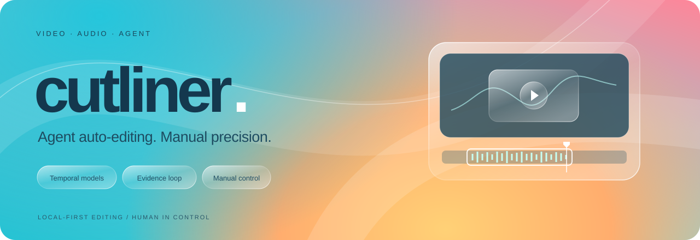
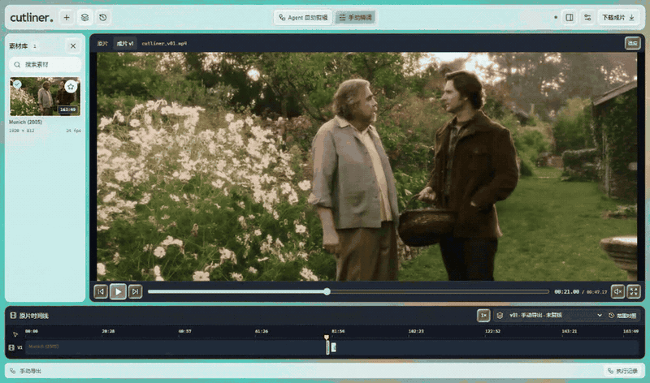
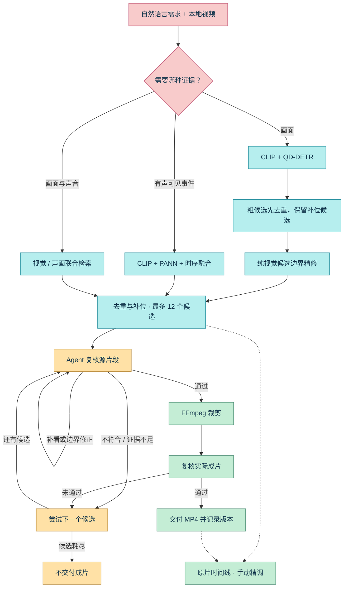

<p align="center">
  <strong>简体中文</strong> · <a href="README.en.md">English</a>
</p>

<p align="center">
  
</p>

<p align="center">
  <strong>从一句需求，到可复核的成片。</strong><br>
  输入你想找的画面或声音，Cutliner 在长视频里定位、取证和裁剪。<br>
  Agent 可以自动完成整条流程，你也可以随时接管时间线。
</p>

<p align="center">
  
  
  
  
</p>

<p align="center">
  <a href="#项目介绍">项目介绍</a> ·
  <a href="#实机演示">实机演示</a> ·
  <a href="#工作原理">工作原理</a> ·
  <a href="#实验结果">实验结果</a> ·
  <a href="#快速开始">快速开始</a> ·
  <a href="#项目结构">项目结构</a>
</p>

## 项目介绍

Cutliner 解决的是**从长素材里找出一段具体内容，再把它剪出来**的问题。比如从整部电影里找「一群男人围坐在桌边吃饭」，从一段长素材里找「画面有狗，同时能听到狗叫」。输入是一段视频和一个自然语言需求，输出是能在原时间线上预览的候选，或一段可下载的 MP4。

| 能力 | 能做什么 |
| :--- | :--- |
| **长视频检索** | 根据需求走视觉、声画或联合路径，返回在原片中的时间区间，而不只是几张相似图片。 |
| **Agent 自动剪辑** | 判断候选是否满足要求，必要时补看、调整边界，再裁剪和复核成片。证据不足时不强行交付。 |
| **手动精调** | 跳转原片，调整入点与出点，对照模型建议、Agent 修正与历史成片范围。支持下载各版本。 |

原视频、成片和工作记录保存在本地。**本地检索不调用云端模型**；授权自动剪辑或复核后，需求文本或选中的候选画面才会发送到配置的服务。

## 实机演示

**《慕尼黑》（2005）· 全片约 2 小时 44 分钟。** 输入「一群男人围坐在桌边吃饭」，首个候选定位到 **00:28:00–00:28:35**。换成「一群人在花园里坐在一个长桌子吃饭」，首个候选定位到 **01:21:15–01:22:30**。

<a href="docs/assets/munich-table-search.jpg">
  
</a>

| 花园长桌 · 首位命中 | 花园谈话 · 47 秒成片预览 |
| :---: | :---: |
| [](docs/assets/munich-garden-search.jpg) | [](docs/assets/munich-clip-preview.jpg) |
| 01:21:15–01:22:30 | 原片 01:20:25–01:21:12 |

### 播放成片与查看范围



<details>
<summary>查看围桌吃饭候选中的 3.5 秒片段</summary>


</details>

同片的「花园谈话摘花」任务在复用全片特征后，**本地检索与边界精修约 27 秒**。这是单次热缓存实测，不含首次提取特征、云端复核或导出。电影画面仅用于演示，仓库不分发原片或完整成片。

## 工作原理



1. **粗检索和候选池。** 模型用稀疏视觉特征定位长片中的相关区间，保留宽画幅完整内容，并缓存同一素材的特征供换词复用。纯视觉路径可重读候选附近的密集画面，用文本条件时序网络修正边界。高度重叠或包含的候选先合并名额，后面的不同区间补位；精修后再检查一次重叠。
2. **Agent 按证据决策。** 模型提出的区间不是审核结果。Agent 可以观察候选帧、调用本地声画检测、补看边界附近；纯视觉自动任务可以提出新区间，但改动后必须重新核验。系统只交付首段同时通过源片段与成片复核的结果。
3. **可追踪的剪辑工作台。** React 工作台共用候选列表和原片时间线。后端用 FFmpeg 处理成片，用 SQLite 或 PostgreSQL 恢复素材、任务和版本记录；服务重启不会自动重发云端调用。

[本地检索](mini_agent/video/neural_retriever.py) · [边界精修](mini_agent/video/boundary_refiner.py) · [复核 Agent](mini_agent/video/review_agent.py) · [导出流程](mini_agent/video/local_search.py)

## 实验结果

| 对照 | 指标 | 基线 → 改进 |
| :--- | :--- | :--- |
| AVE 衍生声画任务：纯视觉 → 声画时序融合 | Macro F1 / R@1（tIoU ≥ 0.5） | **73.3% → 81.0%** / **66.8% → 76.8%** |
| Charades-STA 边界定位：粗定位 Top-1 → 局部精修 + Top-3 重排 | 平均 tIoU / 边界误差 MAE | **0.202 → 0.336** / **8.94 秒 → 6.63 秒** |

声画对照覆盖 215 个独立视频源、28 类事件；边界对照使用 2,355 条有目标查询，均汇总三个固定种子。以上是**组件对照**，不代表端到端成片成功率，也不能把 Top-3 相对 Top-1 的全部增益归给排序器。

[声画评测](docs/evaluation/heldout-results.json) · [边界评测](docs/evaluation/boundary-results.json) · [训练配置](docs/evaluation/training-config.json)

## 快速开始

### 1. 启动本地工作台

验证环境：Windows、Python 3.11、Node.js 22。以下用 SQLite 启动，不依赖 Docker：

```powershell
git clone --recurse-submodules https://github.com/lansunny/cutliner.git
cd cutliner
conda create -n cutliner python=3.11 -y
conda activate cutliner
python -m pip install -r requirements.txt
.\scripts\start-studio.ps1 -Database sqlite
```

打开 [http://127.0.0.1:7861/](http://127.0.0.1:7861/) 导入素材。启动脚本会在必要时构建前端。若已安装 Docker Desktop，运行 `.\scripts\start-studio.ps1` 可启动本机 PostgreSQL。

### 2. 准备本地视觉检索

在仓库根目录创建独立模型环境、安装依赖并下载上游权重。NVIDIA GPU 请参考 [PyTorch CUDA 安装说明](https://pytorch.org/get-started/locally/)。

```powershell
python -m venv experiments/video_grounding_local/.venv
experiments/video_grounding_local/.venv/Scripts/python.exe -m pip install -r requirements-models.txt
experiments/video_grounding_local/.venv/Scripts/python.exe experiments/video_grounding_local/prepare_models.py
```

在工作台选择「手动精调」，打开检索设置，填写英文视觉查询。也可以先用命令行检查本地候选，不调用云端：

```powershell
python video_main.py --video "D:/Videos/input.mp4" --request "找到人物拿起杯子的片段" --visual-query-en "A person picking up a cup" --retrieve-only --no-boundary-refine
```

### 3. 启用 Agent 和自训练模型

- **Agent 自动剪辑**：将 [`.env.example`](.env.example) 复制为本机 `.env`，填写 DeepSeek 和千问的配置并重启。输入需求后需逐任务授权；云端调用可能计费。
- **局部边界精修**：按照[边界模型清单](experiments/boundary_refiner_local/approved_boundary_model.json)准备权重，设置 `LOCAL_BOUNDARY_ARTIFACT_ROOT`。只想验证上游视觉检索时，可设置 `$env:LOCAL_BOUNDARY_MODEL = "off"` 后启动工作台。
- **声画与联合检索**：按照[声画模型清单](experiments/av_grounding_local/approved_event_model.json)准备部署资产，设置 `LOCAL_AV_EVENT_RUN`。自训练权重和训练数据不随仓库分发。

## 项目结构

| 目录或入口 | 职责 |
| :--- | :--- |
| [`frontend/`](frontend/) | 剪辑工作台、预览、时间线与版本对照 |
| [`studio_server.py`](studio_server.py) · [`studio_store.py`](studio_store.py) | 本地 API、任务编排与持久化 |
| [`mini_agent/video/`](mini_agent/video/) | 检索路由、候选池、边界精修、复核与裁剪 |
| [`experiments/`](experiments/) | 本地模型、训练和分模块评测 |
| [`docs/`](docs/) | 演示素材与评测结果 |

## 能力边界

- 声画模型只覆盖 **28 类有声且可见的事件**，不支持具体台词、画外声或否定声音条件。
- 候选匹配不等于逐帧验证。复杂动作和人物关系可能漏检；当目标不存在或证据不足时，系统不保证能判断所有情形。
- 当前自动任务最多交付一段通过复核的成片，不生成多段混剪。视觉精修不改动需要保留声音证据的候选边界。

<sub>模型与数据：[Lighthouse](https://github.com/line/lighthouse) · [QD-DETR](https://github.com/wjun0830/QD-DETR) · [CLIP](https://github.com/openai/CLIP) · [PANNs](https://github.com/qiuqiangkong/audioset_tagging_cnn) · [AVE](https://github.com/YapengTian/AVE-ECCV18) · [Charades-STA](https://github.com/jiyanggao/TALL)。界面：[Vanta](https://github.com/tengbao/vanta) · [Three.js](https://github.com/mrdoob/three.js) · [Ashi Liquid Glass](https://github.com/the-Ashkanian/ashi-liquid-glass) · [Lucide](https://lucide.dev/)。</sub>
